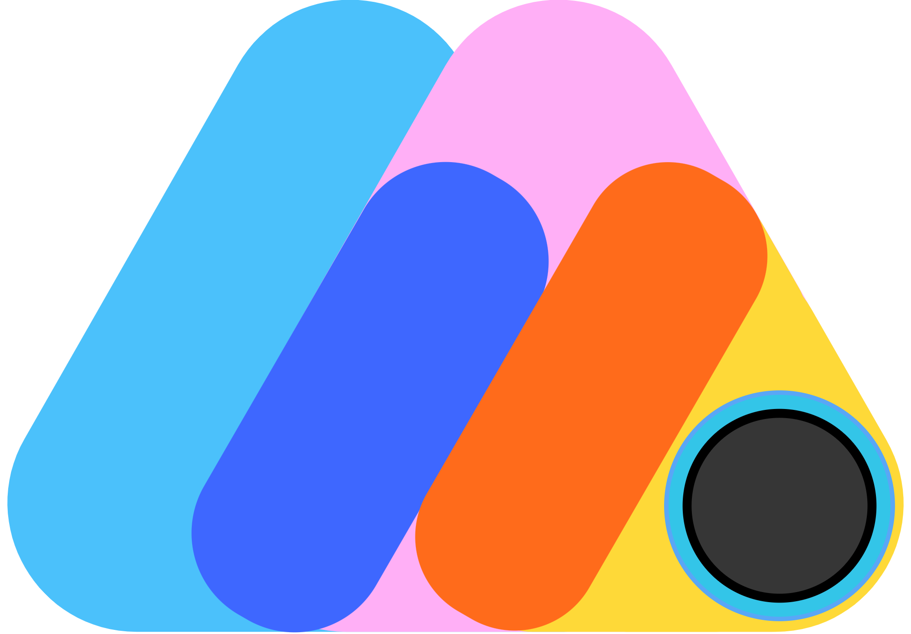

<div align="center">



# meemomini.

### *The Modern, Browser-Native Digital Photo Booth Studio*

Transform any device into a vibrant, aesthetic photo booth. Capture timeless photo strips, dynamic AR lenses, AI background cutouts, and viral boomerang loops — instantly shareable to mobile via QR code with zero app installation.

<br />

[](https://github.com/kicode01/meemomini)
[](https://react.dev/)
[](https://www.typescriptlang.org/)
[](https://developers.google.com/mediapipe)
[](https://tailwindcss.com/)
[](./LICENSE)

<br />

[Explore Features](#-product-highlights) • [Use Cases](#-built-for-every-event--moment) • [Technology Engine](#-intelligent-client-side-engine) • [Privacy by Design](#-privacy--security-by-design) • [Product Vision](#-product-roadmap)

</div>

---

## 🌟 The meemomini Experience

Traditional photo booths require expensive hardware, clunky rental contracts, and tedious setups. **meemomini** redefines the photobooth for the modern web — delivering a studio-quality photo booth experience entirely within your browser.

Whether running on a wedding kiosk iPad, a laptop at a house party, or a smartphone in the palm of your hand, **meemomini** combines cutting-edge client-side computer vision with nostalgic retro aesthetics. Capture physical-quality photo strips, customize every detail in an interactive decor studio, and transfer memories to your phone in seconds.

---

## ✨ Product Highlights

### 📸 Studio-Grade Camera & Capture Suite
* **Multi-Shot Bursts**: Capture 2, 3, or 4 shots in succession with animated countdown timers and authentic shutter sound effects.
* **Dual Capture Modes**: Toggle seamlessly between classic still photo sequences and high-energy **Boomerang motion loops**.
* **Smart Camera Controls**: Multi-camera support (switch front/rear cameras), horizontal mirror flip, screen flash simulation, and adaptive aspect ratio toggling (Portrait & Landscape).
* **Live In-Booth Retake**: Retake individual frames without restarting the entire photo strip sequence.

### 🎭 Real-Time AR Lenses & 40+ Cinematic Filters
* **Face-Tracking AR Filters**: Dynamic headwear, sunglasses, ears, and festive accessories that track your expressions with low latency.
* **40+ Color Grading Filters**: Instant aesthetic transforms ranging from vintage film grains (Clarendon, Gingham, Moon, Reyes, Valencia) to high-contrast cinematic looks (Cyberpunk, Film Noir, Golden Hour, Neon, Matrix, Sunset Boulevard).
* **Real-Time Beauty Polish**: Smooth camera skin tones with customizable intensity sliders directly on live preview.

### 🪄 AI Smart Segmentation & Virtual Studio
* **Edge-Accelerated Background Removal**: Powered by Google MediaPipe AI to isolate subjects in real time directly inside the browser.
* **Virtual Backdrops**: Swap out your physical surroundings with curated aesthetic backdrops, gradient studio walls, or custom scenic environments without green screen equipment.
* **Clean Alpha Cutouts**: Export subjects cleanly for stickers, scrapbook collages, and creative compositions.

### 🎨 Creative Decoration Studio
* **Interactive Sticker Library**: Place, drag, resize, rotate, and style dozens of curated 3D emojis and 2D graphic stickers with custom borders and drop shadows.
* **Freehand Doodle Canvas**: Expressive drawing brush with adjustable thickness, customizable color picker, and eraser controls to sign or doodle on your memories.
* **Typography & Custom Captions**: Personalize strips with customizable timestamps, custom event titles, and curated typography (Outfit, Inter, Open Runde, Playfair Display, Caveat).
* **Custom Watermarks**: Brand your event or booth with customizable watermark logos, contrast colors, and multi-position placement (left, center, right).

### 🎞️ Versatile Photo Strip Layouts & Aesthetics
* **Multiple Strip Geometries**: Choose between Korean-style vertical strips (2, 3, or 4 frames), 2x2 collage grids, or modern horizontal filmstrips.
* **20+ SVG Background Patterns**: Embellish frame backgrounds with procedural SVG patterns including Hearts, Checkerboard, Houndstooth, Polka Dots, Honeycomb, Stripes, Stars, and Waffle.
* **Dual Design Personalities**: Switch on-the-fly between the playful, high-energy **Cartoony Neobrutalist** theme and the sleek, minimalist **Glassmorphism** theme.

### ⚡ Multi-Format High-Fidelity Export
* **Print-Ready High-Res Strips**: Generates crisp 300 DPI-equivalent PNG/JPEG files formatted for standard thermal dye-sublimation strip printers.
* **Animated GIF Generator**: Compiles your multi-frame shots and boomerangs into lightweight, loopable GIFs via dedicated Web Workers.
* **Full Replay Video Export (MP4)**: Stitches live countdowns, photo snapping moments, and animated photo strips into a synchronized MP4 replay video ready for Instagram Stories and TikTok.

### 📲 Frictionless QR Code Mobile Hand-Off
* **Zero App Friction**: Guests scan a dynamic on-screen QR code with their native camera app to immediately open their personal web gallery.
* **Multi-Asset Download**: Recipients can inspect, play, and download their static strip, animated boomerang, and replay video with a single tap.
* **Reliable Cloud Synchronization**: Real-time asset synchronization powered by Firebase and Cloudinary edge media distribution.

---

## 🎯 Built For Every Event & Moment

| Use Case | How meemomini Delivers |
| :--- | :--- |
| **Weddings & Receptions** | Replace expensive rental booths with an iPad kiosk running meemomini. Guests customize strips with wedding dates and take home digital & printed memories. |
| **Brand Pop-Ups & Launches** | Brand the experience with custom watermarks, themed background patterns, and custom event captions that drive organic social sharing. |
| **Parties & Celebrations** | Turn any laptop or monitor into an interactive party station with AR party hats, retro filters, and boomerang loops. |
| **Creators & Scrapbookers** | Craft aesthetic Korean-style photo strips and motion clips for Instagram Reels, TikTok, Pinterest, and personal physical scrapbooks. |

---

## 🧠 Intelligent Client-Side Engine

meemomini is architected for maximum speed, privacy, and responsiveness by performing heavy computation directly on the client device:

```
┌────────────────────────────────────────────────────────┐
│                    meemomini Studio                    │
└────────────────────────────────────────────────────────┘
          │                              │
          ▼                              ▼
┌──────────────────┐           ┌──────────────────┐
│  Live Video Feed │           │ MediaPipe Vision │
│  & AR Face Lenses│           │ AI Segmentation  │
└──────────────────┘           └──────────────────┘
          │                              │
          └──────────────┬───────────────┘
                         ▼
        ┌──────────────────────────────────┐
        │  HTML5 Canvas Compositor Engine  │
        │  • SVG Vector Patterns & Frames  │
        │  • Dynamic Typography & Decors   │
        │  • High-DPI Matrix Rendering     │
        └──────────────────────────────────┘
                         │
         ┌───────────────┼───────────────┐
         ▼               ▼               ▼
 ┌──────────────┐ ┌──────────────┐ ┌──────────────┐
 │ High-Res PNG │ │ Animated GIF │ │  MP4 Replay  │
 │ Print Strip  │ │ (Web Worker) │ │ (mp4-muxer)  │
 └──────────────┘ └──────────────┘ └──────────────┘
                         │
                         ▼
        ┌──────────────────────────────────┐
        │ Instant QR Bridge & Mobile Cloud │
        └──────────────────────────────────┘
```

* **Client-First AI Vision**: Google MediaPipe `ImageSegmenter` and WebGL-accelerated face tracking process video frames locally at smooth frame rates with zero cloud latency.
* **Dual-Layer Compositing Engine**: Separates interactive user interactions (stickers, doodles, live text) from static frame renders to guarantee silky 60 FPS editing.
* **Browser-Native Media Muxing**: Employs `mp4-muxer` and Web Workers to encode high-definition H.264 video and GIF clips without burdening backend server infrastructure.
* **Offline-First PWA Storage**: IndexedDB integration allows sessions to be saved and reviewed even when internet connectivity is spotty.

---

## 🔒 Privacy & Security by Design

* **100% Client-Side Processing**: Camera feeds, facial geometry, and background segmentation are processed exclusively within the local browser sandbox.
* **Ephemeral Sessions**: Photos and recordings remain in local memory during the session; nothing is uploaded to the cloud until you choose to generate a public share link.
* **Zero Intrusive Tracking**: No advertising pixels, invasive fingerprinting, or hidden analytics scripts.

---

## 🎨 Design Philosophy

meemomini bridges tactile physical nostalgia with playful modern interaction design:

* **Tactile Audio Feedback**: Realistic mechanical camera shutter clicks, lively countdown beeps, and UI pop tones create an immersive physical booth feel.
* **Fluid Motion & Micro-Interactions**: Built with Framer Motion for organic page transitions, springy button responses, and physics-based sticker interactions.
* **Accessible & Responsive**: Fully responsive layout optimized for mobile touchscreens, tablet kiosks, and widescreen desktop displays.

---

## 🗺️ Product Roadmap

- [ ] **Collaborative Multi-Phone Booth**: Allow friends to sync multiple phones together to capture multiple angles in a single strip.
- [ ] **Direct Thermal Printer Driver**: WebUSB / WebBluetooth integration for seamless one-tap printing with receipt and photobooth printers.
- [ ] **Custom Event Theme Kits**: Save and export complete branded theme packs (fonts, watermarks, frames, and audio cues) for event organizers.
- [ ] **Generative AI Backdrops**: Optional text-to-backdrop generation to create custom virtual environments on the fly.
- [ ] **Offline Multi-Device Sync**: Local peer-to-peer WebRTC transfer for environments with zero cellular reception.

---

## 📄 License

meemomini is open-source software licensed under the **[MIT License](./LICENSE)**. You are free to inspect, customize, and deploy it for personal, commercial, or event use.

---

<div align="center">

Made with passion for preserving memories.

**[meemomini on GitHub](https://github.com/kicode01/meemomini)** • **[Report an Issue](https://github.com/kicode01/meemomini/issues)** • **[Request a Feature](https://github.com/kicode01/meemomini/issues/new)**

</div>
